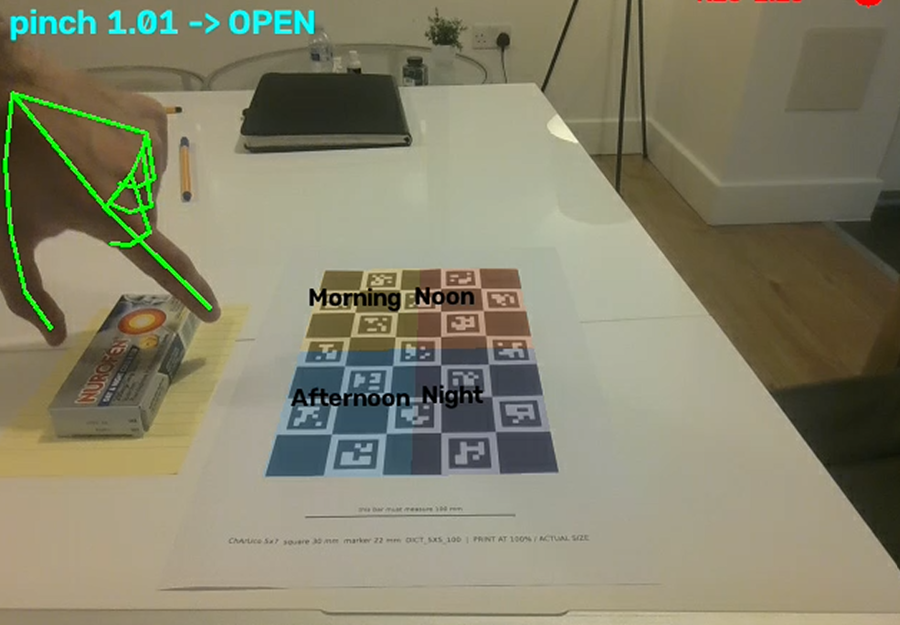
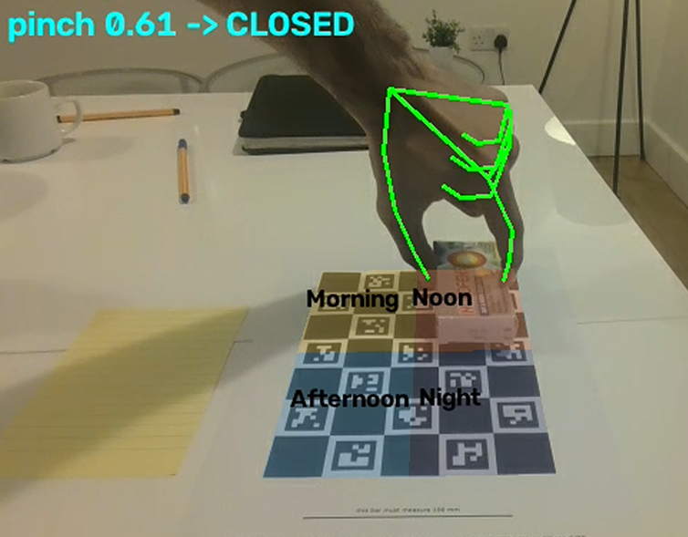
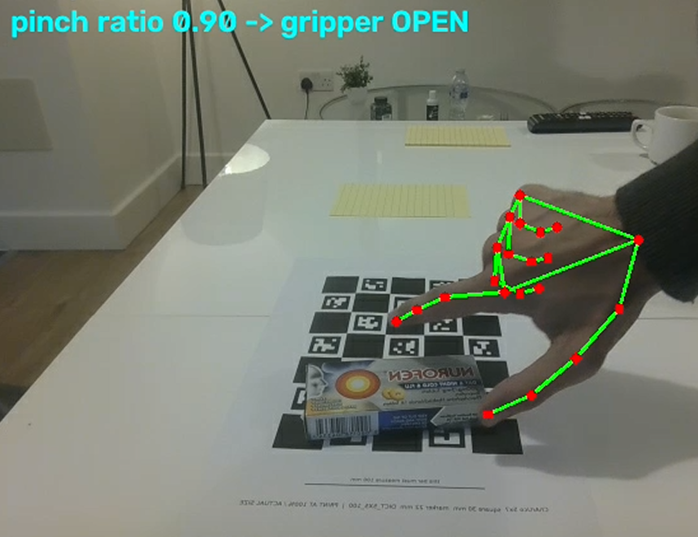
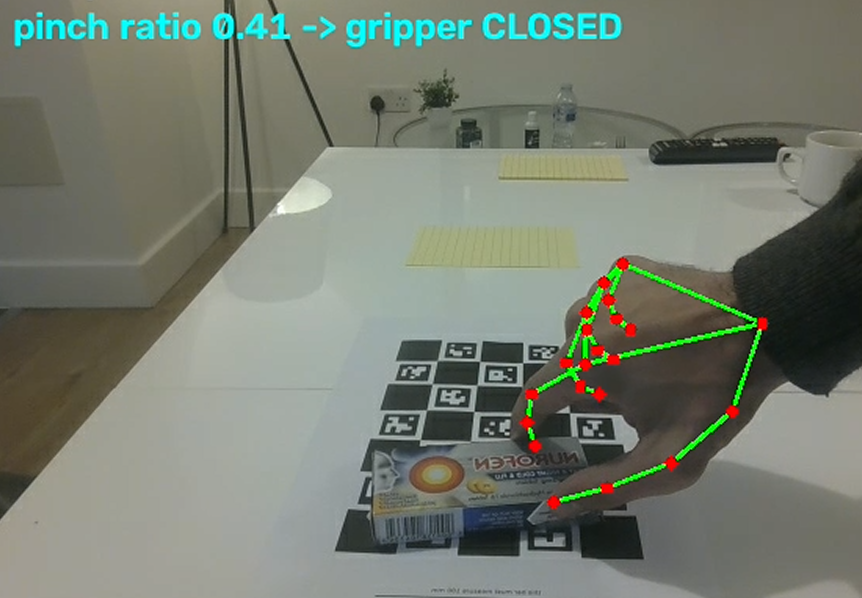
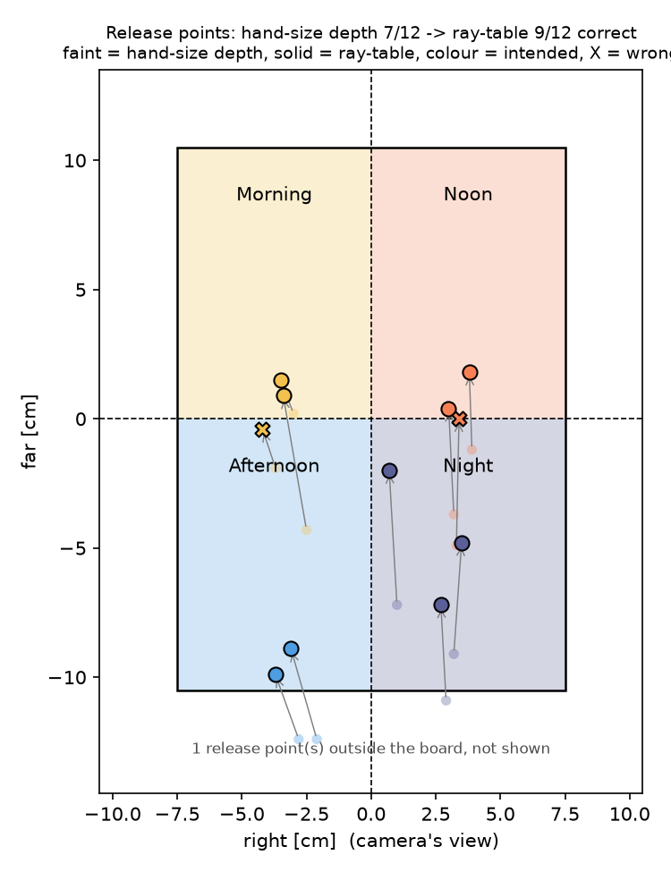
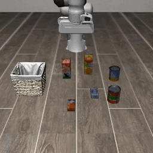
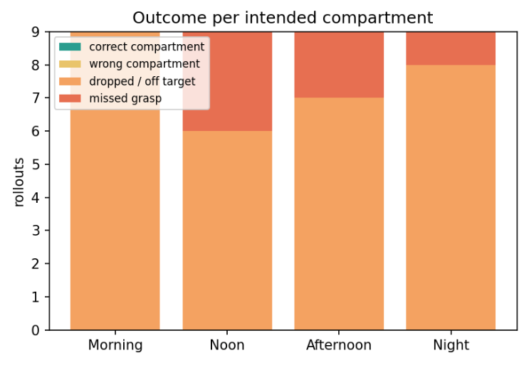

# Pill organiser: driving a robot arm from my own hand demos

I recorded 12 demonstrations of placing a medicine box into one of four "time of day" compartments, extracted where and how my hand moved, and replayed those motions on a Franka Panda in the LIBERO simulator.

## Why this task

Sorting medication into a daily organiser is a repetitive, precise and very human task in care homes and hospitals. A narrow version of it makes a good test for learning from human video: the robot has to reproduce not only how I move, but where I chose to put the item.

**Task:** pick up a small medicine box from a fixed start spot and place it in one of four compartments: **Morning, Noon, Afternoon, Night**.

| Start | End |
|---|---|
|  |  |

## Results

| | Result |
|---|---|
| Demonstrations | 12 (3 per compartment), laptop webcam |
| Compartment recovered from video, hand-size depth | 7/12 |
| Compartment recovered from video, ray–table intersection | **9/12** |
| LIBERO replay: box grasped and lifted | 30/36 rollouts |
| LIBERO replay: box in basket / intended compartment | 0/36 |

Perception works well enough to recover my intent in most demos. The robot replay runs end to end but does not yet succeed, and its failures are systematic, which points to a specific fix (see below).

## Pipeline

1. **Record** (`scripts/live_hand_check.py`): webcam view with live hand skeleton, gripper state and compartment overlay; `r` starts/stops a clip.
2. **Perceive** (`scripts/extract_hand_trajectory.py`): board pose → hand position on the board → grasp and release moments → compartment where the box was released.
3. **Retarget and replay** (`scripts/retarget_replay.py`, Colab): my path is anchored onto the robot's start pose, the object, and the matching compartment inside the LIBERO basket, then tracked by LIBERO's end-effector controller.

The interface between perception and the robot is an **end-effector target plus gripper open/close**. Nothing about the robot's joints appears in my data, which is what makes human video usable for it.

## Setup

- **World frame: a printed ChArUco board** (5 × 7 squares of 30 mm). It doubles as the organiser: its four equal quadrants (75 × 105 mm) are the compartments, named from the camera's point of view (Morning = far-left, Night = near-right).
- **Fixed laptop webcam**, approximate intrinsics from the field of view (no calibration). Because the camera never moves, the last valid board pose is reused while my hand covers the board.
- **Object:** a medicine box (about 10.5 × 4 cm), always starting on a taped spot.

## Gripper state from the hand

| Open | Closed |
|---|---|
|  |  |

`pinch ratio = thumb–index distance / palm length`, with hysteresis: closed below 0.72, open again above 0.85.

- A fixed 3 cm threshold only triggered when my whole hand closed, because MediaPipe's fingertip estimates stay a few cm apart in a pinch. Normalising by palm length and tuning on my own hand fixed it.
- I demonstrated with a two-finger grip, like the robot's parallel gripper, so the signal and the retargeting stay honest.

## Where did the box go? Fixing a systematic depth error



**First version:** hand position from MediaPipe's 3D hand model plus PnP, so depth is inferred from the hand's apparent size. Result: 7/12. Every error was the same kind: **far compartments perceived as near** (Morning → Afternoon, Noon → Night), while left/right was correct on all 12 clips. The far axis points mostly along the camera's line of sight, which is exactly where single-camera depth is weakest.

**Fix:** at release my fingertips are on top of the box, so I cast the camera ray through the fingertips' pixel and intersect it with the table plane (known exactly from the board), raised by the box height. Result: **9/12**. The figure shows both estimates: faint dots for the old method, solid for the new, with arrows showing the correction.

**What's left:** two misses sit right on the near/far boundary, so a small near-bias remains. The assumed fingertip height and the uncalibrated field of view both shift where the ray meets the table. One clip produced an outlier far off the board (not drawn) because the hand was already lifting at the detected release moment; a plausibility check against the board's extent would catch it.

## Robot replay in LIBERO

How a human demo becomes a robot trajectory:
- **From my demo:** motion shape, timing, grasp and release moments, and the compartment I chose.
- **From the simulator:** where the object and basket actually are.
- **Keyframe anchoring:** a time-varying offset makes the path start at the robot's pose, reach the object at my grasp moment, and reach the matching compartment at my release moment, keeping the shape of my motion in between.
- **Compartment mapping:** my release point as a fraction of the board's half-size → the same fraction of the basket's interior.

Task used: LIBERO-Object, "pick up the cream cheese and place it in the basket" (the cream-cheese box stands in for the medicine box).

**Result:** the pipeline runs end to end on real LIBERO (12 demos × 3 scene layouts = 36 rollouts), but the robot does not yet succeed. The box was grasped and lifted in 30/36 rollouts and missed in 6/36, but none landed in the basket.

| One rollout | All 36 rollouts |
|---|---|
|  |  |

<sub>Right panel of the plot is empty because no rollout landed in the basket; it fills in once the replay offset is fixed.</sub>

The failures are systematic, not random:
- **Same landing region whatever the intended compartment.** Demos for all four compartments ended up mostly in the basket's far-right region, about 15–20 cm off target. A constant offset like this points to one shared cause rather than the compartment mapping: most likely the box is released or slips before it reaches the basket, or the basket position reported by the simulator is not the centre of its interior.
- **Missed grasps cluster by demo, not by scene layout.** `noon_01` missed in all three layouts, which points to that demo's grasp timing (the gripper closing before the arm arrives), not to the scene. Demo quality matters as much as the retargeting.

## Design choices

- **Fixed webcam instead of head-mounted video:** steadier board pose, simpler debugging. The board frame already supports a moving camera.
- **Board as both world frame and compartment grid:** one printed sheet gives metric scale and the task layout.
- **Equal compartments,** so accuracy is comparable between them.
- **Relative pinch ratio with hysteresis** instead of a fixed distance.
- **Ray–table intersection at release** instead of hand-size depth.
- **Open-loop replay before any learning,** to measure how far pure retargeting gets on its own.

## Next steps

- **Fix the replay:** watch one rollout video to tell an early release from a wrong target position, correct that single offset, and add a short pause before the gripper closes so the arm arrives first.
- **Closed-loop policy** trained on successful replays, compared with open-loop replay on unseen layouts.
- **Camera calibration** and a stronger 3D hand model (e.g. HaMeR) to remove the residual near-bias.
- **Egocentric recording** with a head-mounted phone.
- **A real organiser scene in LIBERO** (a tray with compartments) instead of a basket, and eventually pill-scale precision.
- **A UMI-style handheld gripper** to measure the gripper opening directly instead of inferring it from the hand.

## Reproduce

```bash
# Laptop (Windows, conda)
conda env create -f environment.yml && conda activate HUMANOID
python scripts/make_print_pdf.py                                   # print at 100%
python scripts/live_hand_check.py --name morning                   # r = record, q = quit
python scripts/extract_hand_trajectory.py "data/raw/*.mp4" --grasp_height 0.04

# Colab (LIBERO needs Linux), after installing lerobot with the [libero] extra
MUJOCO_GL=egl PYOPENGL_PLATFORM=egl python scripts/retarget_replay.py --n_init 3 --save_videos 1
```

Trajectories for all 12 demos are in `trajectories/`, and perception results in `results/`, so every number above can be regenerated without the raw videos.

## The End

Thank you for setting this challenge and for taking the time to go through my attempt!

You're an inspiration.

<sub>Built on a Windows laptop webcam and a Colab T4 GPU, with all demonstration data recorded by me. AI was used responsibly.</sub>